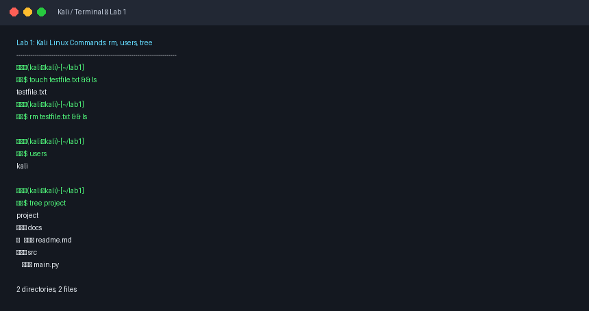

# Lab 1: Kali Linux Commands: rm, users, tree

## Commands / Code

```bash
# 1. rm command - remove files or directories
touch testfile.txt
ls
rm testfile.txt
ls

# 2. users command - display currently logged-in users
users

# 3. tree command - display directory structure in tree format
mkdir -p project/src project/docs
touch project/src/main.py project/docs/readme.md
tree project
```

## Expected Output

```text
┌──(kali㉿kali)-[~/lab1]
└─$ touch testfile.txt && ls
testfile.txt
┌──(kali㉿kali)-[~/lab1]
└─$ rm testfile.txt && ls

┌──(kali㉿kali)-[~/lab1]
└─$ users
kali

┌──(kali㉿kali)-[~/lab1]
└─$ tree project
project
├── docs
│   └── readme.md
└── src
    └── main.py

2 directories, 2 files
```

## Output Image


