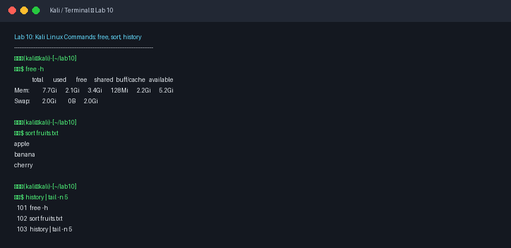

# Lab 10: Kali Linux Commands: free, sort, history

## Commands / Code

```bash
# 1. free - display amount of free and used memory
free -h

# 2. sort - sort lines of text files
printf "banana\napple\ncherry\n" > fruits.txt
sort fruits.txt

# 3. history - display command history
history | tail -n 5
```

## Expected Output

```text
┌──(kali㉿kali)-[~/lab10]
└─$ free -h
               total        used        free      shared  buff/cache   available
Mem:           7.7Gi       2.1Gi       3.4Gi       128Mi       2.2Gi       5.2Gi
Swap:          2.0Gi          0B       2.0Gi

┌──(kali㉿kali)-[~/lab10]
└─$ sort fruits.txt
apple
banana
cherry

┌──(kali㉿kali)-[~/lab10]
└─$ history | tail -n 5
  101  free -h
  102  sort fruits.txt
  103  history | tail -n 5
```

## Output Image


