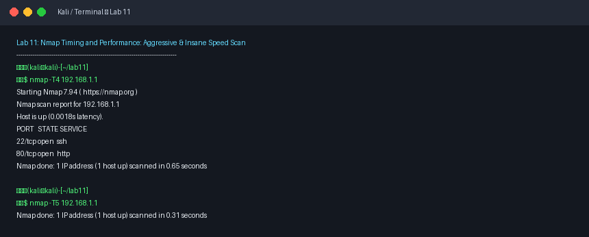

# Lab 11: Nmap Timing and Performance: Aggressive & Insane Speed Scan

## Commands / Code

```bash
# i) Aggressive speed scan (-T4)
nmap -T4 192.168.1.1

# ii) Insane speed scan (-T5)
nmap -T5 192.168.1.1
```

## Expected Output

```text
┌──(kali㉿kali)-[~/lab11]
└─$ nmap -T4 192.168.1.1
Starting Nmap 7.94 ( https://nmap.org )
Nmap scan report for 192.168.1.1
Host is up (0.0018s latency).
PORT   STATE SERVICE
22/tcp open  ssh
80/tcp open  http
Nmap done: 1 IP address (1 host up) scanned in 0.65 seconds

┌──(kali㉿kali)-[~/lab11]
└─$ nmap -T5 192.168.1.1
Nmap done: 1 IP address (1 host up) scanned in 0.31 seconds
```

## Output Image


