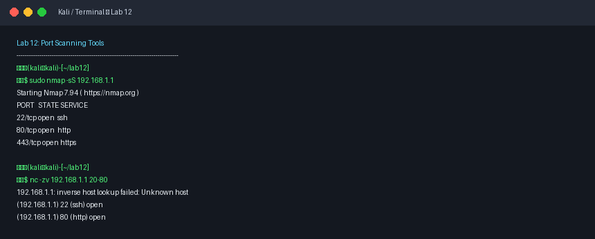

# Lab 12: Port Scanning Tools

## Commands / Code

```bash
# 1. Nmap SYN stealth scan
sudo nmap -sS 192.168.1.1

# 2. Netcat port scan
nc -zv 192.168.1.1 20-80
```

## Expected Output

```text
┌──(kali㉿kali)-[~/lab12]
└─$ sudo nmap -sS 192.168.1.1
Starting Nmap 7.94 ( https://nmap.org )
PORT   STATE SERVICE
22/tcp open  ssh
80/tcp open  http
443/tcp open https

┌──(kali㉿kali)-[~/lab12]
└─$ nc -zv 192.168.1.1 20-80
192.168.1.1: inverse host lookup failed: Unknown host
(192.168.1.1) 22 (ssh) open
(192.168.1.1) 80 (http) open
```

## Output Image


