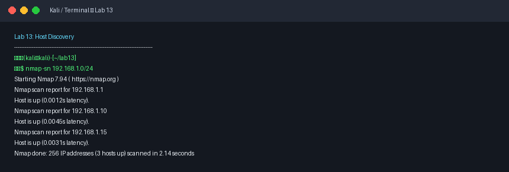

# Lab 13: Host Discovery

## Commands / Code

```bash
# 1. Ping sweep using Nmap (-sn disables port scan)
nmap -sn 192.168.1.0/24

# 2. ARP scan on local network
sudo netdiscover -r 192.168.1.0/24 -P
```

## Expected Output

```text
┌──(kali㉿kali)-[~/lab13]
└─$ nmap -sn 192.168.1.0/24
Starting Nmap 7.94 ( https://nmap.org )
Nmap scan report for 192.168.1.1
Host is up (0.0012s latency).
Nmap scan report for 192.168.1.10
Host is up (0.0045s latency).
Nmap scan report for 192.168.1.15
Host is up (0.0031s latency).
Nmap done: 256 IP addresses (3 hosts up) scanned in 2.14 seconds
```

## Output Image


