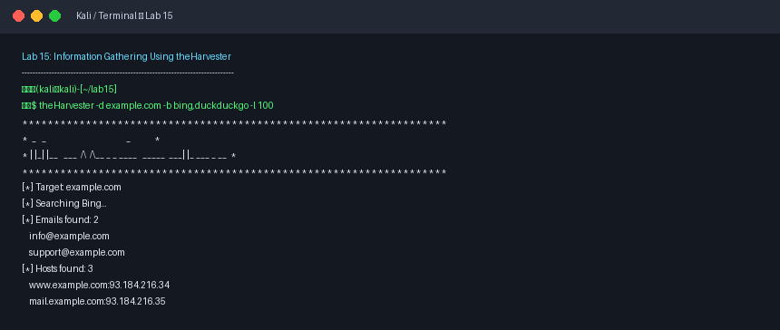

# Lab 15: Information Gathering Using theHarvester

## Commands / Code

```bash
# Gather emails, subdomains, and hosts for a target domain
theHarvester -d example.com -b bing,duckduckgo -l 100
```

## Expected Output

```text
┌──(kali㉿kali)-[~/lab15]
└─$ theHarvester -d example.com -b bing,duckduckgo -l 100
*******************************************************************
*  _   _                                            _             *
* | |_| |__   ___  /\  /\__ _ _ ____   _____  ___| |_ ___ _ __  *
*******************************************************************
[*] Target: example.com
[*] Searching Bing...
[*] Emails found: 2
    info@example.com
    support@example.com
[*] Hosts found: 3
    www.example.com:93.184.216.34
    mail.example.com:93.184.216.35
```

## Output Image


