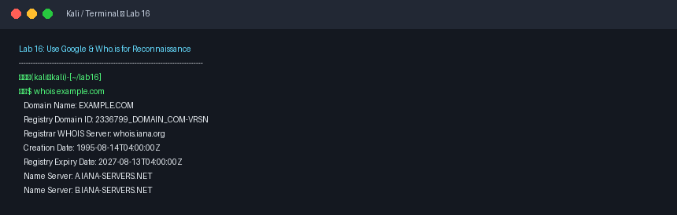

# Lab 16: Use Google & Who.is for Reconnaissance

## Commands / Code

```bash
# 1. WHOIS lookup from Kali Linux terminal
whois example.com

# 2. Google Dorking examples (run in browser)
# site:example.com filetype:pdf
# site:example.com intitle:"index of"
```

## Expected Output

```text
┌──(kali㉿kali)-[~/lab16]
└─$ whois example.com
   Domain Name: EXAMPLE.COM
   Registry Domain ID: 2336799_DOMAIN_COM-VRSN
   Registrar WHOIS Server: whois.iana.org
   Creation Date: 1995-08-14T04:00:00Z
   Registry Expiry Date: 2027-08-13T04:00:00Z
   Name Server: A.IANA-SERVERS.NET
   Name Server: B.IANA-SERVERS.NET
```

## Output Image


