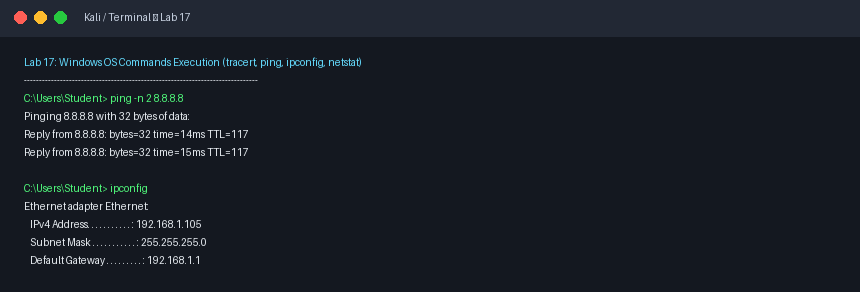

# Lab 17: Windows OS Commands Execution (tracert, ping, ipconfig, netstat)

## Commands / Code

```cmd
:: 1. Trace route to target
tracert 8.8.8.8

:: 2. Test network connectivity
ping -n 4 8.8.8.8

:: 3. Display IP configuration
ipconfig /all

:: 4. Display active network connections
netstat -an
```

## Expected Output

```text
C:\Users\Student> ping -n 2 8.8.8.8
Pinging 8.8.8.8 with 32 bytes of data:
Reply from 8.8.8.8: bytes=32 time=14ms TTL=117
Reply from 8.8.8.8: bytes=32 time=15ms TTL=117

C:\Users\Student> ipconfig
Ethernet adapter Ethernet:
   IPv4 Address. . . . . . . . . . . : 192.168.1.105
   Subnet Mask . . . . . . . . . . . : 255.255.255.0
   Default Gateway . . . . . . . . . : 192.168.1.1
```

## Output Image


