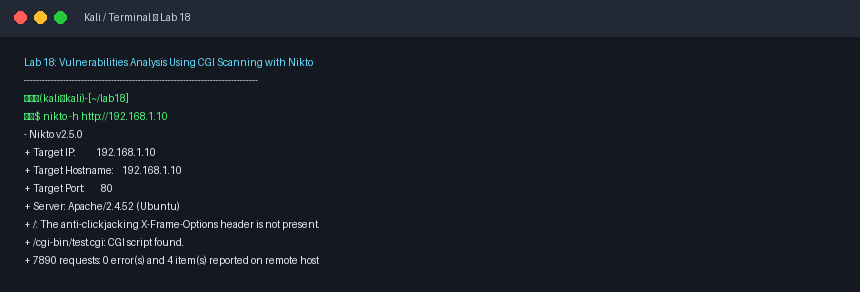

# Lab 18: Vulnerabilities Analysis Using CGI Scanning with Nikto

## Commands / Code

```bash
# Scan a web server for vulnerabilities and CGI issues using Nikto
nikto -h http://192.168.1.10
```

## Expected Output

```text
┌──(kali㉿kali)-[~/lab18]
└─$ nikto -h http://192.168.1.10
- Nikto v2.5.0
+ Target IP:          192.168.1.10
+ Target Hostname:    192.168.1.10
+ Target Port:        80
+ Server: Apache/2.4.52 (Ubuntu)
+ /: The anti-clickjacking X-Frame-Options header is not present.
+ /cgi-bin/test.cgi: CGI script found.
+ 7890 requests: 0 error(s) and 4 item(s) reported on remote host
```

## Output Image


