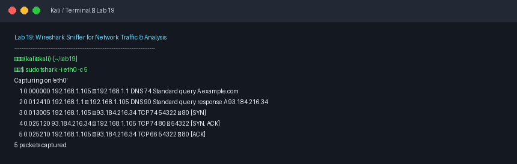

# Lab 19: Wireshark Sniffer for Network Traffic & Analysis

## Commands / Code

```bash
# Capture 10 packets on eth0 using tshark (CLI companion to Wireshark)
sudo tshark -i eth0 -c 10

# Or launch Wireshark GUI
wireshark &
```

## Expected Output

```text
┌──(kali㉿kali)-[~/lab19]
└─$ sudo tshark -i eth0 -c 5
Capturing on 'eth0'
    1 0.000000 192.168.1.105 → 192.168.1.1 DNS 74 Standard query A example.com
    2 0.012410 192.168.1.1 → 192.168.1.105 DNS 90 Standard query response A 93.184.216.34
    3 0.013005 192.168.1.105 → 93.184.216.34 TCP 74 54322 → 80 [SYN]
    4 0.025120 93.184.216.34 → 192.168.1.105 TCP 74 80 → 54322 [SYN, ACK]
    5 0.025210 192.168.1.105 → 93.184.216.34 TCP 66 54322 → 80 [ACK]
5 packets captured
```

## Output Image


