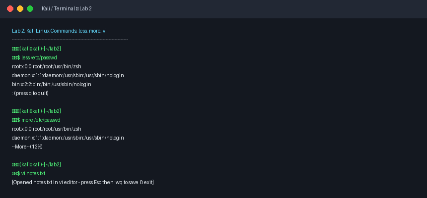

# Lab 2: Kali Linux Commands: less, more, vi

## Commands / Code

```bash
# 1. less command - view file content page by page (supports backward/forward)
less /etc/passwd

# 2. more command - view file content one screen at a time
more /etc/passwd

# 3. vi command - open/edit a file in vi text editor
vi notes.txt
```

## Expected Output

```text
┌──(kali㉿kali)-[~/lab2]
└─$ less /etc/passwd
root:x:0:0:root:/root:/usr/bin/zsh
daemon:x:1:1:daemon:/usr/sbin:/usr/sbin/nologin
bin:x:2:2:bin:/bin:/usr/sbin/nologin
: (press q to quit)

┌──(kali㉿kali)-[~/lab2]
└─$ more /etc/passwd
root:x:0:0:root:/root:/usr/bin/zsh
daemon:x:1:1:daemon:/usr/sbin:/usr/sbin/nologin
--More--(12%)

┌──(kali㉿kali)-[~/lab2]
└─$ vi notes.txt
[Opened notes.txt in vi editor - press Esc then :wq to save & exit]
```

## Output Image


