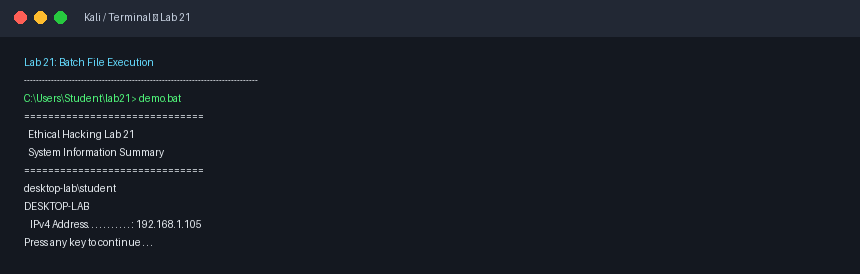

# Lab 21: Batch File Execution

## Commands / Code

```bat
@echo off
echo ==============================
echo   Ethical Hacking Lab 21
echo   System Information Summary
echo ==============================
whoami
hostname
ipconfig | findstr IPv4
pause
```

## Expected Output

```text
C:\Users\Student\lab21> demo.bat
==============================
  Ethical Hacking Lab 21
  System Information Summary
==============================
desktop-lab\student
DESKTOP-LAB
   IPv4 Address. . . . . . . . . . . : 192.168.1.105
Press any key to continue . . .
```

## Output Image


