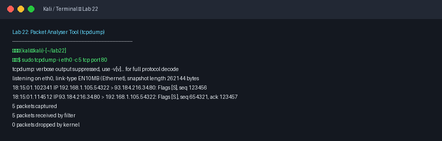

# Lab 22: Packet Analyser Tool (tcpdump)

## Commands / Code

```bash
# Capture HTTP/TCP packets on interface eth0 using tcpdump
sudo tcpdump -i eth0 -c 5 tcp port 80
```

## Expected Output

```text
┌──(kali㉿kali)-[~/lab22]
└─$ sudo tcpdump -i eth0 -c 5 tcp port 80
tcpdump: verbose output suppressed, use -v[v]... for full protocol decode
listening on eth0, link-type EN10MB (Ethernet), snapshot length 262144 bytes
18:15:01.102341 IP 192.168.1.105.54322 > 93.184.216.34.80: Flags [S], seq 123456
18:15:01.114512 IP 93.184.216.34.80 > 192.168.1.105.54322: Flags [S.], seq 654321, ack 123457
5 packets captured
5 packets received by filter
0 packets dropped by kernel
```

## Output Image


