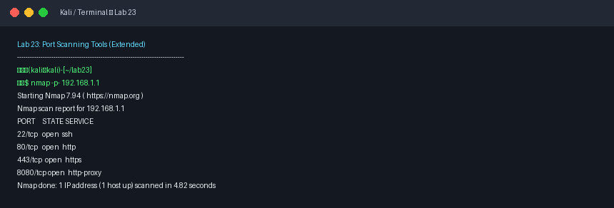

# Lab 23: Port Scanning Tools (Extended)

## Commands / Code

```bash
# 1. Nmap full port scan (1-65535)
nmap -p- 192.168.1.1

# 2. Masscan fast port scan
sudo masscan 192.168.1.0/24 -p80,443 --rate=1000
```

## Expected Output

```text
┌──(kali㉿kali)-[~/lab23]
└─$ nmap -p- 192.168.1.1
Starting Nmap 7.94 ( https://nmap.org )
Nmap scan report for 192.168.1.1
PORT     STATE SERVICE
22/tcp   open  ssh
80/tcp   open  http
443/tcp  open  https
8080/tcp open  http-proxy
Nmap done: 1 IP address (1 host up) scanned in 4.82 seconds
```

## Output Image


