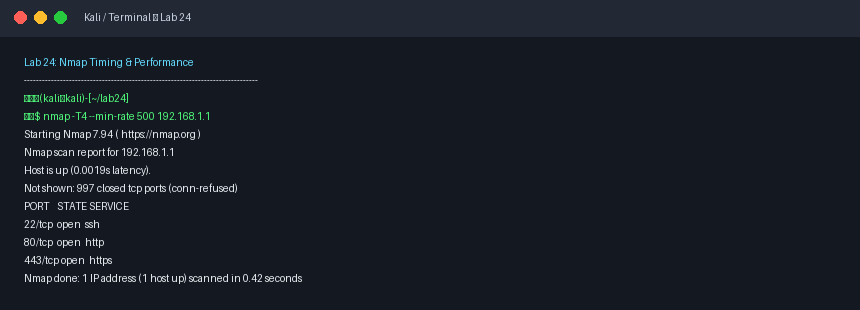

# Lab 24: Nmap Timing & Performance

## Commands / Code

```bash
# Compare scan timing templates (-T0 Paranoid to -T5 Insane)
nmap -T1 --scan-delay 500ms 192.168.1.1
nmap -T4 --min-rate 500 192.168.1.1
```

## Expected Output

```text
┌──(kali㉿kali)-[~/lab24]
└─$ nmap -T4 --min-rate 500 192.168.1.1
Starting Nmap 7.94 ( https://nmap.org )
Nmap scan report for 192.168.1.1
Host is up (0.0019s latency).
Not shown: 997 closed tcp ports (conn-refused)
PORT    STATE SERVICE
22/tcp  open  ssh
80/tcp  open  http
443/tcp open  https
Nmap done: 1 IP address (1 host up) scanned in 0.42 seconds
```

## Output Image


