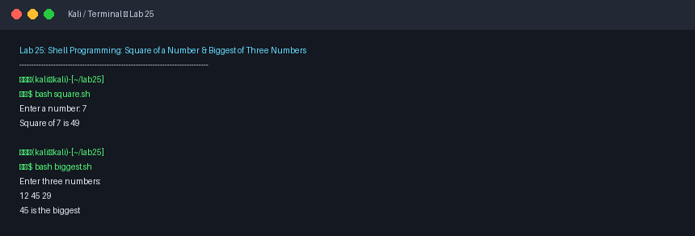

# Lab 25: Shell Programming: Square of a Number & Biggest of Three Numbers

## Commands / Code

```bash
# i) Read a number and find its square (square.sh)
#!/bin/bash
echo -n "Enter a number: "
read n
sq=$((n * n))
echo "Square of $n is $sq"

# ii) Find the biggest of three numbers (biggest.sh)
#!/bin/bash
echo "Enter three numbers:"
read a b c
if [ $a -ge $b ] && [ $a -ge $c ]; then
    echo "$a is the biggest"
elif [ $b -ge $a ] && [ $b -ge $c ]; then
    echo "$b is the biggest"
else
    echo "$c is the biggest"
fi
```

## Expected Output

```text
┌──(kali㉿kali)-[~/lab25]
└─$ bash square.sh
Enter a number: 7
Square of 7 is 49

┌──(kali㉿kali)-[~/lab25]
└─$ bash biggest.sh
Enter three numbers:
12 45 29
45 is the biggest
```

## Output Image


