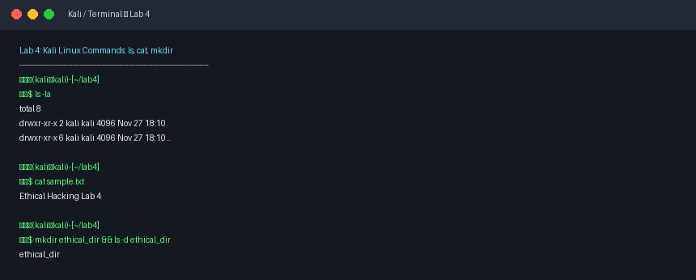

# Lab 4: Kali Linux Commands: ls, cat, mkdir

## Commands / Code

```bash
# i) ls - list directory contents
ls -la

# ii) cat - create and display file contents
cat > sample.txt << EOF
Ethical Hacking Lab 4
EOF
cat sample.txt

# iii) mkdir - create a new directory
mkdir ethical_dir
ls -d ethical_dir
```

## Expected Output

```text
┌──(kali㉿kali)-[~/lab4]
└─$ ls -la
total 8
drwxr-xr-x 2 kali kali 4096 Nov 27 18:10 .
drwxr-xr-x 6 kali kali 4096 Nov 27 18:10 ..

┌──(kali㉿kali)-[~/lab4]
└─$ cat sample.txt
Ethical Hacking Lab 4

┌──(kali㉿kali)-[~/lab4]
└─$ mkdir ethical_dir && ls -d ethical_dir
ethical_dir
```

## Output Image


