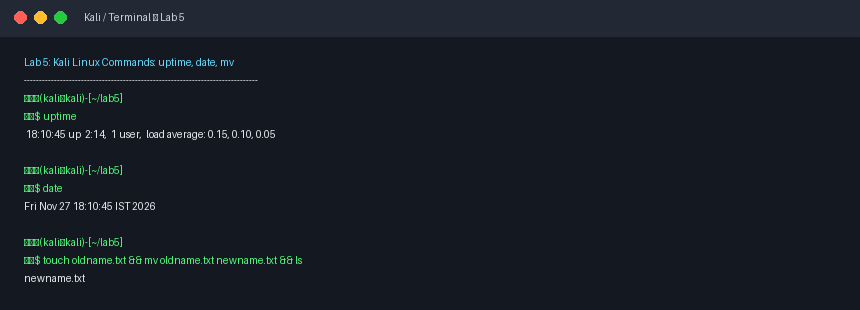

# Lab 5: Kali Linux Commands: uptime, date, mv

## Commands / Code

```bash
# i) uptime - show how long the system has been running
uptime

# ii) date - display current system date and time
date

# iii) mv - move or rename a file
touch oldname.txt
mv oldname.txt newname.txt
ls
```

## Expected Output

```text
┌──(kali㉿kali)-[~/lab5]
└─$ uptime
 18:10:45 up  2:14,  1 user,  load average: 0.15, 0.10, 0.05

┌──(kali㉿kali)-[~/lab5]
└─$ date
Fri Nov 27 18:10:45 IST 2026

┌──(kali㉿kali)-[~/lab5]
└─$ touch oldname.txt && mv oldname.txt newname.txt && ls
newname.txt
```

## Output Image


