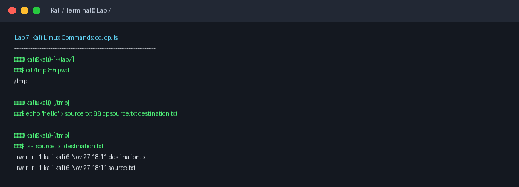

# Lab 7: Kali Linux Commands: cd, cp, ls

## Commands / Code

```bash
# 1. cd - change directory
cd /tmp
pwd

# 2. cp - copy files
echo "hello" > source.txt
cp source.txt destination.txt

# 3. ls - list files
ls -l source.txt destination.txt
```

## Expected Output

```text
┌──(kali㉿kali)-[~/lab7]
└─$ cd /tmp && pwd
/tmp

┌──(kali㉿kali)-[/tmp]
└─$ echo "hello" > source.txt && cp source.txt destination.txt

┌──(kali㉿kali)-[/tmp]
└─$ ls -l source.txt destination.txt
-rw-r--r-- 1 kali kali 6 Nov 27 18:11 destination.txt
-rw-r--r-- 1 kali kali 6 Nov 27 18:11 source.txt
```

## Output Image


