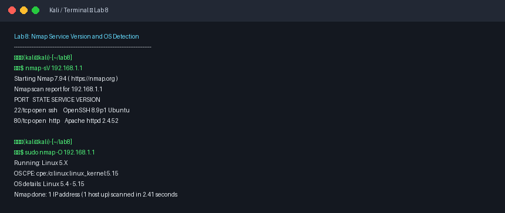

# Lab 8: Nmap Service Version and OS Detection

## Commands / Code

```bash
# i) Detect the version of services running
nmap -sV 192.168.1.1

# ii) Aggressive scan (OS, version, script, traceroute)
nmap -A 192.168.1.1

# iii) Detect operating system of the target
sudo nmap -O 192.168.1.1
```

## Expected Output

```text
┌──(kali㉿kali)-[~/lab8]
└─$ nmap -sV 192.168.1.1
Starting Nmap 7.94 ( https://nmap.org )
Nmap scan report for 192.168.1.1
PORT   STATE SERVICE VERSION
22/tcp open  ssh     OpenSSH 8.9p1 Ubuntu
80/tcp open  http    Apache httpd 2.4.52

┌──(kali㉿kali)-[~/lab8]
└─$ sudo nmap -O 192.168.1.1
Running: Linux 5.X
OS CPE: cpe:/o:linux:linux_kernel:5.15
OS details: Linux 5.4 - 5.15
Nmap done: 1 IP address (1 host up) scanned in 2.41 seconds
```

## Output Image


