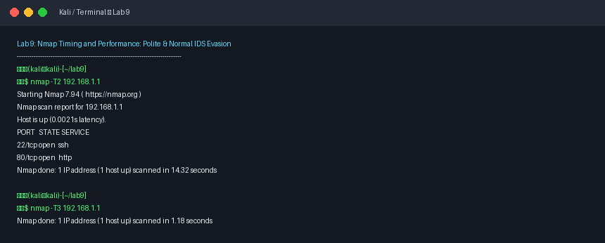

# Lab 9: Nmap Timing and Performance: Polite & Normal IDS Evasion

## Commands / Code

```bash
# i) Polite IDS evasion (-T2 slows down scan to use less bandwidth/evade IDS)
nmap -T2 192.168.1.1

# ii) Normal IDS evasion (-T3 is default normal timing)
nmap -T3 192.168.1.1
```

## Expected Output

```text
┌──(kali㉿kali)-[~/lab9]
└─$ nmap -T2 192.168.1.1
Starting Nmap 7.94 ( https://nmap.org )
Nmap scan report for 192.168.1.1
Host is up (0.0021s latency).
PORT   STATE SERVICE
22/tcp open  ssh
80/tcp open  http
Nmap done: 1 IP address (1 host up) scanned in 14.32 seconds

┌──(kali㉿kali)-[~/lab9]
└─$ nmap -T3 192.168.1.1
Nmap done: 1 IP address (1 host up) scanned in 1.18 seconds
```

## Output Image


